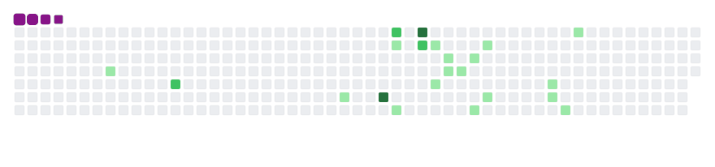

## Hi, I'm Vadith 👋

**Frontend Engineer · Design Systems & AI Tooling** — Bogotá, Colombia (remote)

I build and maintain a React + TypeScript component library used across multiple product teams: accessible components (WCAG), design tokens, Vitest/Playwright tests and CI pipelines. Lately I build **MCP servers** so AI agents can generate UI that actually follows the design system.

*Desarrollador frontend enfocado en sistemas de diseño, accesibilidad y herramientas con IA.*

- ⚛️ Daily stack: React, TypeScript, Redux, React Router, microfrontends, REST + JWT
- 🧪 Quality: Vitest, Testing Library, Playwright, SonarQube, Azure DevOps CI/CD
- 🤖 AI tooling: Claude Code, MCP servers, subagents · 6 Anthropic Academy certificates
- 🚀 Side project: **EXORA**, AI sales automation for WhatsApp & Instagram built with n8n
- 💬 Ask me about: design tokens, component APIs, accessible comboboxes, AI-assisted migrations

  &nbsp;
  &nbsp;
  &nbsp;
  &nbsp;
  &nbsp;
  &nbsp;
  &nbsp;
  &nbsp;
  &nbsp;
  &nbsp;
  &nbsp;
  &nbsp;
  

  
  

